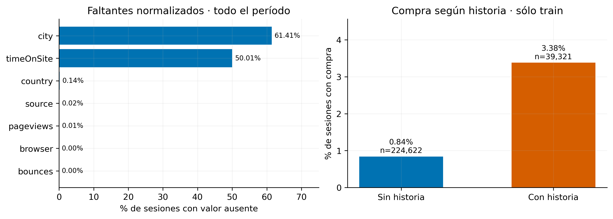
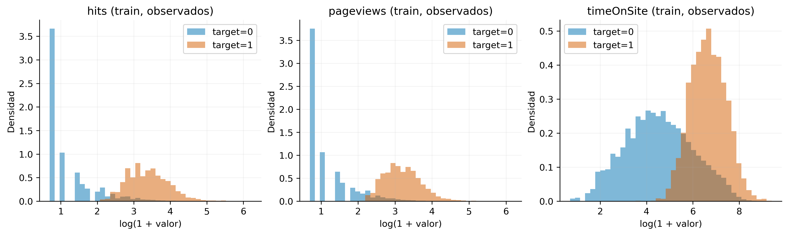
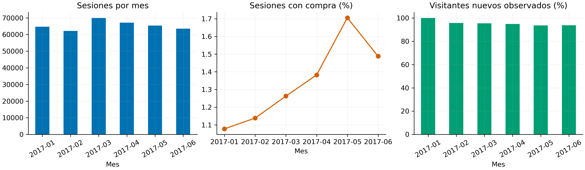

# Dataset de sesiones: hallazgos y decisiones

392,892 sesiones completas, 308,130 visitantes y 15 variables originales. Período: 2017-01-01 a 2017-06-30. Hay 5,277 sesiones con compra (1.34%). El objetivo actual es clasificar sesiones terminadas; los agregados pueden incluir consecuencias de la compra y no permiten validar anticipación online.

## Variables y tratamiento

| grupo | variables | tratamiento |
|---|---|---|
| Identidad y fecha | fullVisitorID, date, visitNumber | ID como texto para historia; no como predictor. Fecha para split y calendario. visitNumber es un contador, no una clave. |
| Actividad | hits, pageviews, timeOnSite, bounces | Totales de sesión. Conservar faltantes e indicadores; probar log1p en contadores y duración. hits cuenta acciones, incluyendo páginas y clicks; duración en segundos. |
| Contexto | source, channelGrouping, browser, deviceCategory, country, city | Categorías; codificar y resolver valores nuevos usando sólo entrenamiento. |
| Resultado | transactions, transactionRevenue | Target: transactions > 0. Excluir ambas columnas y sus indicadores de ausencia de las features. |

## Calidad: lo esencial

No hay duplicados exactos, valores numéricos negativos/infinitos ni inconsistencias detectadas entre compras e ingresos. Hay 403 repeticiones de usuario + visitNumber entre fechas y 59,346 filas en grupos usuario-día con varias sesiones. No deduplicar por usuario ni ordenar sesiones del mismo día sin timestamps.

| variable | hallazgo | decisión |
|---|---|---|
| timeOnSite | 50.01% vacío | No asumir cero segundos. Conservar indicador y ajustar imputación sólo con train. |
| bounces | 49.88% con rebote; resto sin rebote | Definición confirmada: null original se codifica como 0; no es un faltante desconocido. |
| pageviews | 36 vacíos | Conservar e imputar dentro del pipeline. |
| city | 228,132 ocultas en demo; 13,157 no definidas | Son motivos distintos; el procesamiento actual los combina. Probar una variante sin ciudad. |
| transactions / revenue | Ambas vacías en las mismas sesiones | Se asume que transactions vacío significa cero compras registradas; confirmar con la fuente. |

El diccionario proporcionado confirma las definiciones de las variables, incluida duración en segundos y rebote null=0. Revenue contiene decimales en el CSV pese a declararse INTEGER; no se fuerza a entero. Su moneda/escala y la zona horaria siguen sin documentarse. No se eliminan extremos automáticamente: las variables de actividad tienen colas largas.

Referencia semántica: [esquema oficial de Universal Analytics](https://support.google.com/analytics/answer/3437719?hl=en).

Izquierda: ausencias después de normalizar categorías, sobre todo el período. Derecha: tasas de compra en train; cada barra indica el volumen de sesiones. bounces ya está normalizado a 0/1: los null originales significan sin rebote.

## Historia y señales para investigar

Entre los meses posteriores al primero, 93.7%–95.8% de los visitantes son nuevos en el archivo. Sin historia observada no equivale a primera visita real. El modelo debe funcionar bien para usuarios sin antecedentes disponibles.

| historia en entrenamiento | sesiones | compras | tasa de compra % |
|---|---|---|---|
| con días previos | 39321 | 1329 | 3.3799 |
| sin días previos | 224622 | 1887 | 0.8401 |

La diferencia es una asociación descriptiva, no causal. La historia incluye número de sesiones y sesiones con compra, tasa de compra, medias de actividad y días desde última sesión/compra. Usa sólo días anteriores; sin historia, contadores=0 y medias/recencias=faltantes. Comparar modelos con y sin historia.

Las sesiones con compra muestran más actividad y casi siempre duración observada. Esto puede reflejar tanto intención como efectos posteriores a la compra. La disponibilidad de ciudad también se asocia con el resultado y podría reflejar el mecanismo del dataset demo.

Las distribuciones se normalizan por separado para comparar formas pese al desbalance. El eje usa log(1 + valor); duración incluye sólo valores observados. La separación no demuestra anticipación de compras.

## Evaluación y próximos baselines

| partición | filas | compras | tasa compra % |
|---|---|---|---|
| train | 263943 | 3216 | 1.2184 |
| validation | 65371 | 1115 | 1.7056 |
| test | 63578 | 946 | 1.4879 |

Validación desde 2017-05-01; test desde 2017-06-01; fechas anteriores para entrenamiento. Cambian la tasa de compra y la mezcla de fuentes/canales: mantener el split temporal. La historia se actualiza día a día, también dentro de validación/test, sin ajustar el modelo con esas filas.

Baselines: probabilidad constante aprendida en train; regresión logística con contexto y actividad; misma logística con historia. Añadir comparaciones sólo contexto y sin ciudad para entender de dónde viene la señal. Optimizar log loss y acompañar con Average Precision, Brier y calibración, globales y según presencia de historia. Reservar resultados de modelos en test para el cierre.

El primer mes muestra 100% de visitantes nuevos por inicio del registro; no implica que todos visitaran el sitio por primera vez.

## Referencia y reproducción

Las asociaciones con compra se calcularon sólo en train; los controles de calidad y cobertura describen todo el período. El test ya fue observado descriptivamente. Los CSV conservan el detalle para consultas puntuales.

[Diccionario completo](data_dictionary.csv)

[Controles de calidad](quality_checks.csv)

[Distribuciones numéricas](numeric_quantiles.csv)

[Categorías y desconocidas](category_audit.csv)

[Evolución mensual](monthly.csv)

Reproducir desde la raíz: PYTHONPATH=src python -m autoresearch_purchase_propensity.eda_detail --config configs/data.json. No modifica el CSV ni los Parquet.
